# PitchLens Studio

**Telestration and explainable match intelligence for TV pundits and fans.**
Built for the Microsoft x Premier League **Inside the Game** hackathon
(challenge: *The Synthetic Match Insights Engine for Premier League Studio*).

**Live demo:** [pitchlens-studio-5169.azurewebsites.net](https://pitchlens-studio-5169.azurewebsites.net) · **Video:** [youtu.be/P8NhUwjZ3bE](https://youtu.be/P8NhUwjZ3bE) · **Sample report:** [PDF](https://pitchlens-studio-5169.azurewebsites.net/reports/demo/report.pdf)

> Everything shown runs on **synthetic, football-realistic data** that we generate
> ourselves: fictional teams, fictional players, no real clubs, crests, names or footage.

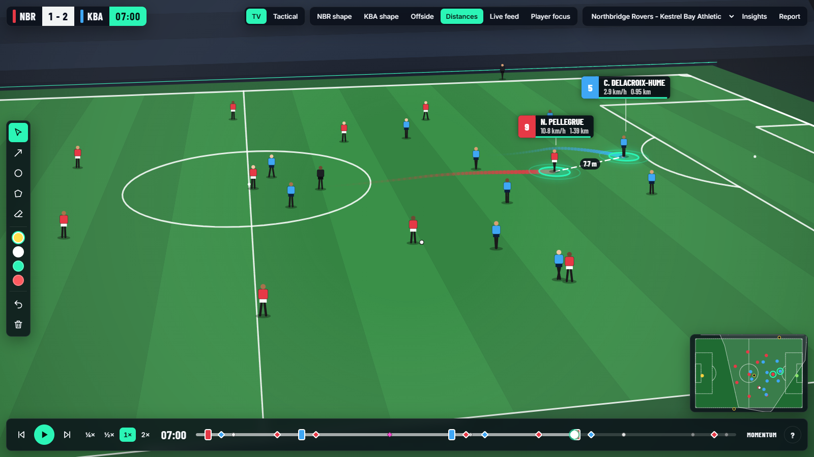

## The problem

A studio pundit has seconds to explain a moment: who was offside and by how much,
why the back line was caught, who controlled the build-up. Today that means
switching between stats tools and a telestrator, and the explanation reaches every
viewer the same way, whether they are a data-hungry analyst or a casual fan.

## What PitchLens does

It follows the challenge's pipeline end to end: **ingest** synthetic events as the
match plays, **interpret** them into statistics, **explain** why a moment matters,
**render** it on screen next to the match, and **personalize** it per viewer. After
the final whistle it also writes the **match report**.

| | |
|---|---|
| 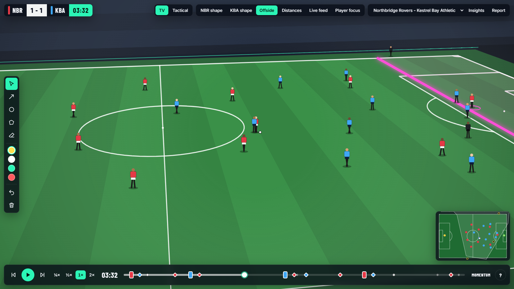 | 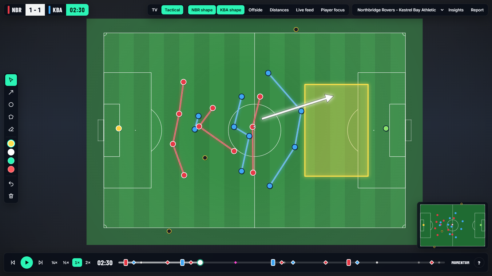 |
| **Telestration studio.** TV, tactical and 3D views with smooth transitions. Click players for rings, trails and speed/distance cards; formation lines, offside line, distances; arrows, circles and zones stay on the grass in every view. | **Tactics at a glance.** Both teams' shapes, the pundit's own drawings, and a minimap of what the camera shows. |
| 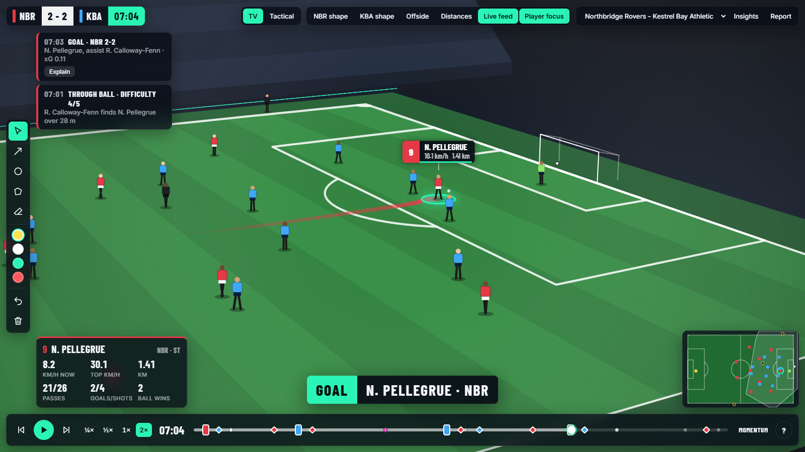 | 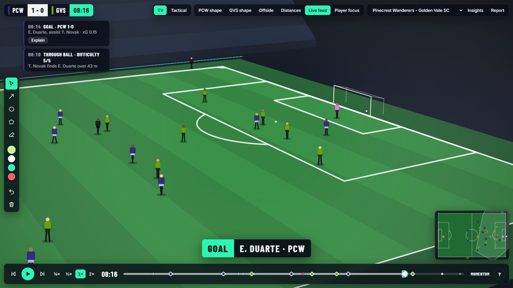 |
| **Live feed and player focus.** Cards while the match plays: goals, saves, offsides, through balls with a 1-5 pass difficulty rating, sprint alerts above 30 km/h, distance milestones, momentum swings. Player focus makes the camera follow one player with a live stat card. | **Four matches.** A full demo match and three scenarios, each with its own teams and formations: a possession battle, an offside-heavy attack and a counter-attacking side. Switch between them from the top bar. |
| 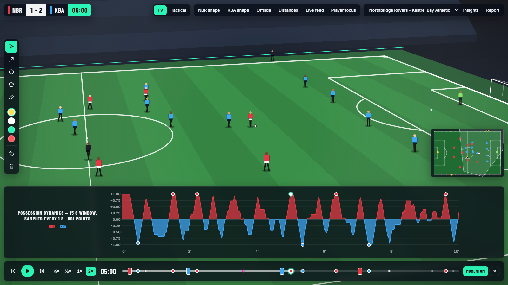 | 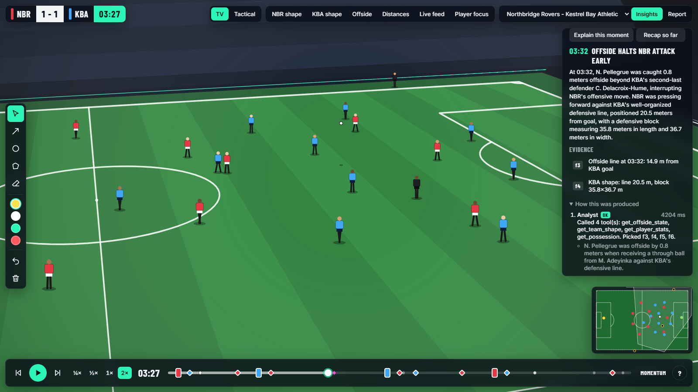 |
| **Possession dynamics (M).** Who controls the ball, second by second (15 s window), with the peaks marked and the playhead lined up with the timeline. | **AI analyst.** *Explain this moment* and *Recap so far*, answered by four agents on Microsoft Foundry, with the evidence behind every sentence and the trace of how it was produced. |
| 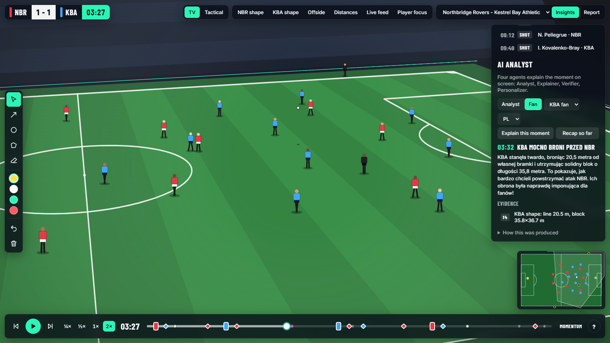 | 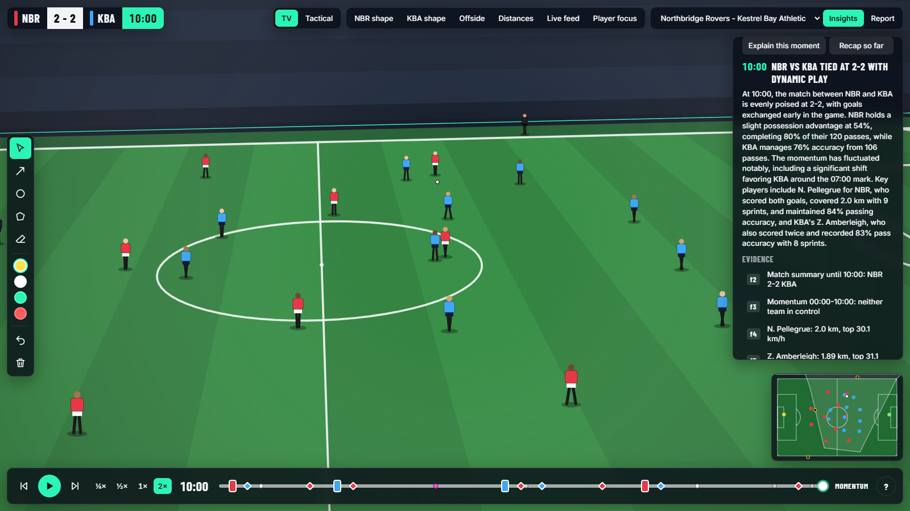 |
| **Personalized.** The same verified facts for an analyst or a fan, a favourite club and player, in English, Polish or Spanish. | **Recaps.** The story of the match so far: score, chances, possession, the biggest swing in control, the decisive players. |
| 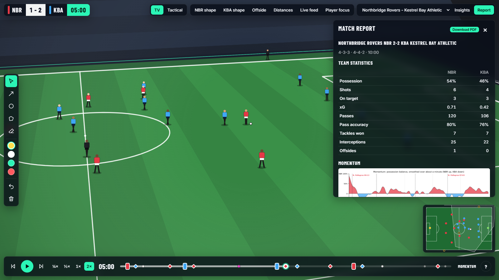 | 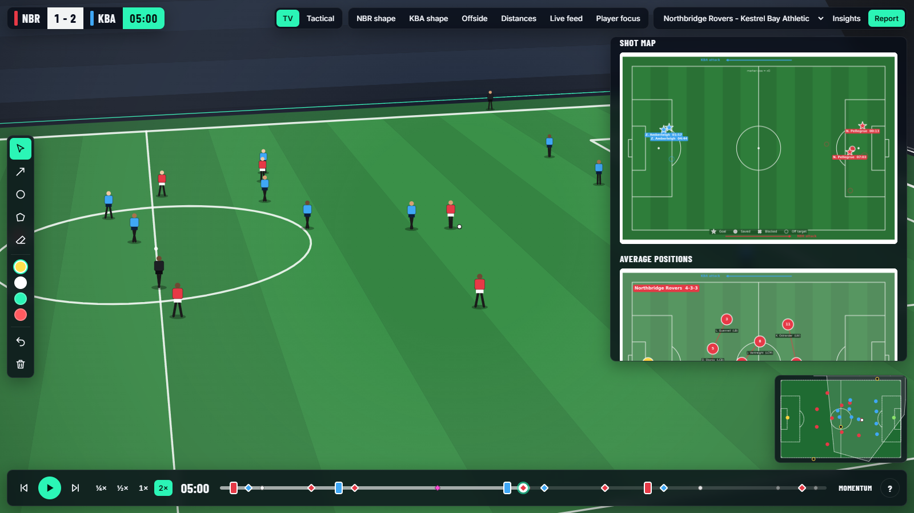 |
| **Match report.** Team statistics, momentum, top players and key moments (click one to jump there). | **Maps and PDF.** Shot map (marker size = xG), average positions, heat maps per team, and a downloadable PDF typeset in LaTeX. |

## How the AI analyst works

Four specialised agents share one session state, a store of numbered facts.
Deterministic tools compute **every** number; the model never does arithmetic.

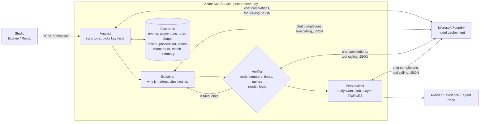

- **Analyst**: calls up to six tools (offside state at the pass, the defending
  team's shape before a shot, momentum of the build-up, zones the pundit drew...)
  and selects the 3 to 6 facts that matter. It writes no narrative.
- **Explainer**: 2 to 4 sentences on *why* the moment matters (3 to 5 for a recap);
  every sentence cites the ids of its facts.
- **Verifier**: code checks that every number, clock time and player name appears
  in the facts, then the model checks the logic (wrong team, a tackle called an
  interception...). Problems go back to the Explainer once; sentences that are
  still unsupported are dropped. The trace shows every revision.
- **Personalizer**: rewrites the verified text for the viewer without adding facts,
  and its output is checked again.

**Reliability.** Each step falls back to fact-backed templates if the model fails,
so the endpoint always answers. A 38 s budget bounds every request, a model error
(for example a rate limit) is retried once and never cached, and the demo match's
key moments and recaps are precomputed with the real model (`api/precompute.py`)
for instant, repeatable answers. Every request logs the agents' status and timing
for Application Insights.

**Responsible AI.** The model only receives structured parameters (time, style,
language, player id), never free text from the public, the deployment uses Azure AI
Content Safety filters, and every claim on screen is traceable to a computed fact.

## Match reports

`scripts/build_reports.py` turns each match into a report at build time: the same
fact tools produce the statistics, matplotlib draws the momentum chart, shot map,
average positions and heat maps, and `pdflatex` typesets them into `report.pdf`.
The studio's **Report** panel shows it live (`GET /api/report?dataset=…`, plus
`/api/report.tex` and `/api/report.pdf`), with the PDF one click away.

## Microsoft technologies

| | |
|---|---|
| **Microsoft Foundry** (Azure OpenAI) | `gpt-4.1-mini` deployment behind the four agents: tool calling and JSON outputs |
| **Azure App Service** (Linux, Python 3.11) | one standard-library server for the studio, `/api/explain` and `/api/report` |
| **Application Insights** | per-request agent trace (status, timing, model calls, tokens) |
| **GitHub Actions** | tests the agents, builds the reports (matplotlib + LaTeX) and the studio, and deploys to App Service on every push |

## Data

Organisers distribute no match data, so we built our own (`pitchlens_synth/`): 22
players and the ball simulated at 50 Hz and recorded at 10 Hz, formations that
shift with the ball, walking to sprinting, offside-aware runs, passes (through and
lofted), shots with xG, saves, tackles, interceptions, offsides, restarts and
officials. Every match is reproducible from its seed:

| match | teams | formations | result |
|---|---|---|---|
| demo (seed 20) | Northbridge Rovers vs Kestrel Bay Athletic | 4-3-3 vs 4-4-2 | 2-2 |
| possession battle (seed 7) | Harbour City FC vs Redwood Athletic | 4-2-3-1 vs 4-4-2 | 0-0 |
| offside attack (seed 42) | Silverlake United vs Eastgate Borough | 4-3-3 vs 4-2-3-1 | 0-1 |
| transition attack (seed 99) | Pinecrest Wanderers vs Golden Vale SC | 4-4-2 vs 4-3-3 | 1-0 |

All sources share one format, documented in [`docs/schema.md`](docs/schema.md).

Our CV pipeline (`pitchlens_cv/`: YOLOv8 detection, ByteTrack tracking, team colours,
camera calibration) produces the same format from broadcast video. It was tested
locally on publicly available sample clips
([roboflow/sports](https://github.com/roboflow/sports)); that footage is never
published, deployed or shown in the demo.

## Run it locally

```bash
python api/server.py            # AI analyst and report API on :7071 (standard library only)
cd web
npm install
npm run dev                     # studio on http://localhost:5173
```

On Windows, `start.bat` starts both. Without model settings the analyst answers
from its templates; to use the model, copy `api/local.settings.example.json` to
`api/local.settings.json` and fill in the Foundry endpoint, key and deployment.
For the report figures and PDF: `pip install matplotlib`, a LaTeX distribution, then
`python scripts/build_reports.py`.

Tests (no Azure needed; a scripted model exercises the Verifier's revision loop):

```bash
cd api
python -m unittest discover -s tests -v
```

Deployment to Azure: [`docs/deploy.md`](docs/deploy.md). Screenshots and the demo
video are scripted in `scripts/demo/`.

**Shortcuts:** Space play/pause · ←/→ 5 s · Shift+←/→ key moments · 1/2 views ·
V A C Z E tools · O offside · D distances · L live feed · F player focus ·
M possession dynamics · ? help.

## Repository layout

| path | what |
|---|---|
| `pitchlens_synth/` | synthetic match generator |
| `web/` | studio (Vite + TypeScript + canvas 2D, no framework); demo and scenario data in `web/public/data/` |
| `api/` | `server.py` (studio, `/api/explain`, `/api/report`), agents, tools, verifier, templates, report rendering, tests |
| `pitchlens_cv/` | CV pipeline for local video (detection, tracking, calibration, export) |
| `scripts/` | `build_reports.py` (LaTeX/PDF reports), `build_site.py` (App Service package), `demo/` scripted screenshots and video |
| `docs/` | data format, deployment guide, screenshots |

## Known limitations

- The synthetic match models behaviour, not physics: no dribbles or fouls, few corners.
- Events are replayed from a file in real time; the format is ready for a live stream.
- Recaps are computed as of whole half-minutes so they can be precomputed; answers
  for the three scenarios are generated live.
